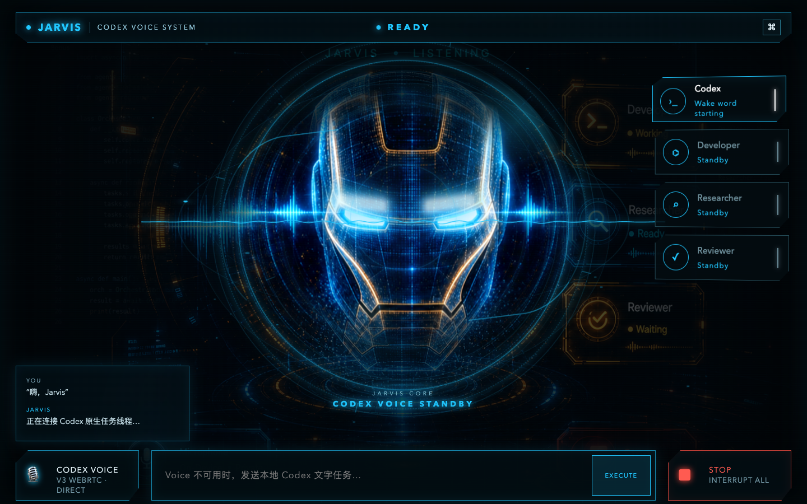
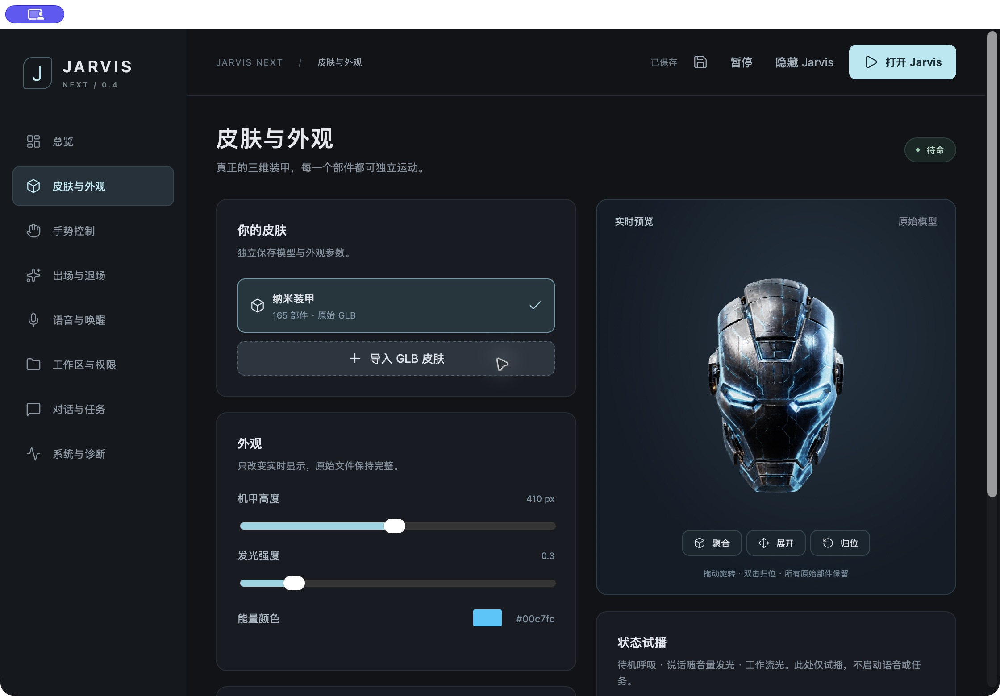

<p align="center">
  
</p>

<h1 align="center">Jarvis × Codex</h1>

<p align="center">Wake Codex from your desktop with “Hey Jarvis.”</p>

<p align="center">
  English · <a href="README.zh-CN.md">简体中文</a> ·
  <a href="https://github.com/Big-Guan/jarvis-codex/releases/tag/v0.4.7">Download 0.4.7</a> ·
  <a href="docs/USAGE.zh-CN.md">User guide (中文)</a> ·
  <a href="CHANGELOG.md">Evolution & changelog</a>
</p>

<p align="center">
  
</p>

Jarvis × Codex is a voice workspace for macOS. Say the wake phrase and a transparent armor avatar appears on your desktop, then connects to Codex Voice. Speak naturally, interrupt a response, or ask it to perform real work in your selected folder. Voice, text, tools, and tasks share one Codex thread.

The current main branch contains **Jarvis Next 0.4.7**: real 3D armor, a separate settings panel, one-hand and mouse controls, and quiet wake. Next uses independent application and settings identifiers, so it can be installed alongside the original Jarvis Codex. The previous source is preserved on [`legacy/jarvis-codex-v0.2`](https://github.com/Big-Guan/jarvis-codex/tree/legacy/jarvis-codex-v0.2); the existing [v0.2.0 download](https://github.com/Big-Guan/jarvis-codex/releases/tag/v0.2.0) belongs to that older version.

## What it does

- **Conversation and real work.** On-device “Hi / Hey Jarvis” and Chinese wake phrases hand over to Codex app-server V3 / WebRTC. Continue a conversation, send text tasks, handle approvals, or use STOP.
- **Quiet wake.** Show the avatar and connect Voice without reopening settings or requesting a greeting. Jarvis waits for your actual request.
- **Separate desktop and settings.** Configure skins, appearance, audio, gestures, workspace, and permissions in the panel. The clean desktop avatar and panel can coexist without interrupting Voice.
- **Real 3D and an animated entrance.** 165 independent meshes retain their original geometry and textures. Flight from a distance, repeated impacts, progressive fragmentation, and central reassembly are configurable, with quick and off modes.
- **One-hand and mouse controls.** Open-palm rotation and fragment spacing, pinch-to-move, and fist-to-assemble. Mouse drag, movement, zoom, and reset work without a camera.
- **Visible activity.** Idle breathing, actual audio-level-driven illumination, and a working-state light sweep. Glow and motion are adjustable.
- **Your workspace.** Keep instructions, an introduction, source materials, and deliverables in a selected folder. Each workspace resumes its own thread.

## Visual evolution

### v0.1.x — holographic workstation



The first version kept task roles, transcripts, text input, and STOP in a persistent HUD, making Codex's work visible.

### v0.2.0 — transparent character interface

<p align="center">
  
</p>

The character became the center of the desktop interface, with particle assembly, armor fragments, and effects driven by activity. This stage used character imagery and animation while retaining the existing voice and workspace capabilities.

### 3D exploration → v0.4.x — Jarvis Next

A segmented model prototype introduced armor that could actually rotate, separate, and reassemble. Next brought it into an application with an independent settings GUI and transparent desktop window. Subsequent updates added left/right-hand recognition, mouse controls, desktop-owned Voice, pause and hide actions, state lighting, and quiet wake.



*Native appearance panel captured in 0.4.6 and retained in 0.4.7. Settings stay in the panel; the desktop avatar has no hover toolbar. See the [changelog](CHANGELOG.md) for the version history.*

## Download and install

[Download Jarvis Next 0.4.7 for Apple Silicon](https://github.com/Big-Guan/jarvis-codex/releases/download/v0.4.7/Jarvis-Next_0.4.7_arm64.dmg), for M-series Macs running macOS 14+. Open the DMG and drag `Jarvis Next.app` into Applications. The installer includes the armor and gesture assets; Node.js, Rust, Tripo, and Blender are not required. Voice still needs a signed-in, compatible Codex installation.

**This package is ad-hoc signed. It has no Apple Developer ID signature and has not been notarized by Apple.** macOS may block the first launch. After verifying the download source and published checksum, follow [Apple's instructions](https://support.apple.com/en-us/102445) to use **System Settings → Privacy & Security → Open Anyway** for this application. The release also includes SHA-256 checksums.

Next uses a different application identifier from the original Jarvis Codex. After installation, select your own workspace in the panel, then configure microphone, wake, and gesture permissions.

## Build from source

Requires macOS 14+, Xcode Command Line Tools, Rust stable with `rustfmt` and `clippy`, and Node.js 20.19+ or 22.12+. Local verification was on Apple Silicon; CI uses Node 22. Voice also requires a signed-in local Codex installation with compatible V3 / WebRTC support.

```sh
git clone https://github.com/Big-Guan/jarvis-codex.git jarvis-next
cd jarvis-next
npm ci
npm run check
npm run build
open "src-tauri/target/release/bundle/macos/Jarvis Next.app"
```

After building, you can also use `打开 Jarvis Next.command`. Local builds use ad-hoc signing. The wake and desktop helpers explicitly target macOS 14 so they do not inherit a newer build machine's minimum OS version.

```sh
npm run dev      # Native Tauri app
npm run web:dev  # Browser preview at http://127.0.0.1:4400
```

The browser previews the model, motion, and settings. Native transparency, wake detection, Voice, and task execution require the macOS app. Windows and Linux native builds are not included.

## First use

1. In **工作区与权限** (Workspace & permissions), select an existing folder and permission profile, then save.
2. Configure **语音与唤醒** (Voice & wake). Enable local wake listening if desired, and grant microphone and speech-recognition access.
3. Click **打开 Jarvis** or say the wake phrase. Once connected, Jarvis listens without a second start button.
4. Reopen settings from the menu bar. Enable the camera only if you want gestures; mouse controls work by default.

| Control | Behavior |
| --- | --- |
| Open palm / pinch / fist | Rotate and adjust fragments / move / reassemble, then rotate |
| Left drag / Shift + left or right drag | Rotate / move |
| Wheel / double-click | Temporary zoom / reset to the slightly upward-facing pose |
| Pause / resume | Stop or restore audio and gesture interaction; an active task continues |
| Hide avatar | Hide the model and release the camera; Voice and tasks continue |
| Stop all | End Voice and cancel tasks |

Pause, hide, and STOP live in the panel and menu bar. “Only show avatar” and “Preview entrance” do not start Voice. Workspace setup, introductions, and troubleshooting are covered in the [user guide (中文)](docs/USAGE.zh-CN.md).

## Connection, permissions, and data

On-device wake helper → release microphone → avatar-owned WebRTC → Codex app-server V3 → workspace thread. The avatar owns audio; the settings panel controls the same session. Jarvis reuses local Codex authentication.

| Profile | Sandbox / approval policy | Use |
| --- | --- | --- |
| Safe | `workspace-write` / `on-request` | Confirm operations when needed |
| Auto | `workspace-write` / `never` | Work autonomously inside the workspace |
| Full | `danger-full-access` / `never` | Explicitly selected broader file access |

Camera frames are processed locally, without being stored or uploaded by the gesture pipeline. Voice and tasks connect to Codex services. Settings and imported skins live under `~/Library/Application Support/com.bigguan.jarvis-next/`; task files stay in your selected workspace. Hiding the avatar does not stop microphone capture; use Pause or Stop all.

Jarvis checks the local Codex protocol for V3 / WebRTC compatibility. Set `JARVIS_NEXT_CODEX_BIN` to select an executable explicitly. An incompatible runtime reports a Voice error while still allowing text tasks. Launching Jarvis does not silently enable login startup.

## Checks and contributions

Run `npm run check` and `npm run build` before submitting changes. Checks cover 33 TypeScript and 11 Rust tests, frontend compilation, formatting, and Clippy; an additional installed-Codex check is opt-in. Changes to wake, audio, camera, or packaging also need a real macOS smoke test.

Desktop Voice has been confirmed in user testing, and quiet wake has a simulated-wake check. Automated tests do not establish real wake-word recognition rates, gesture quality, or long-running stability. Codex realtime APIs are experimental and may need compatibility updates. Feedback and improvements are welcome through Issues and Pull Requests.

Code is distributed under [GPL-3.0](LICENSE). Third-party components retain their own notices; see [model and asset notes](docs/ASSETS.md). This is an independent client built around Codex interfaces.
