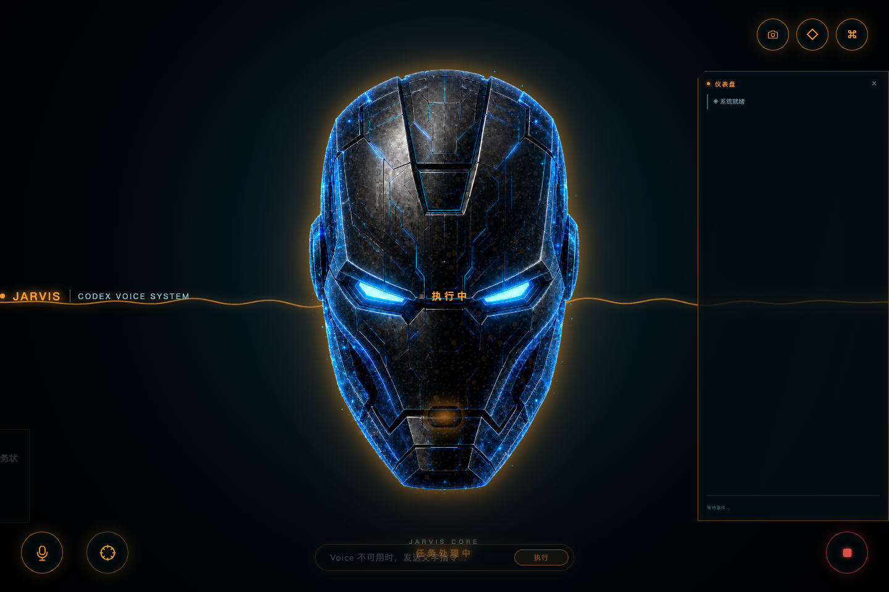
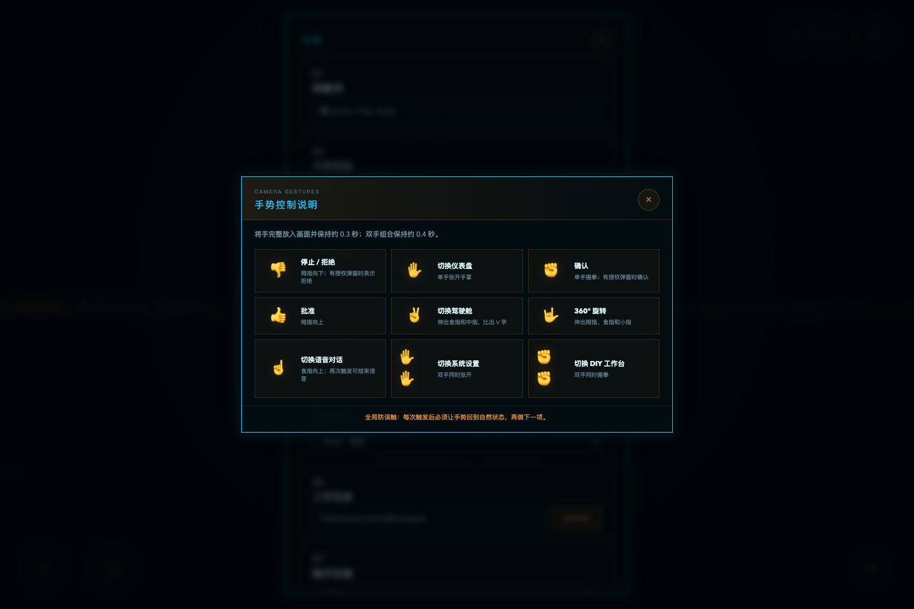
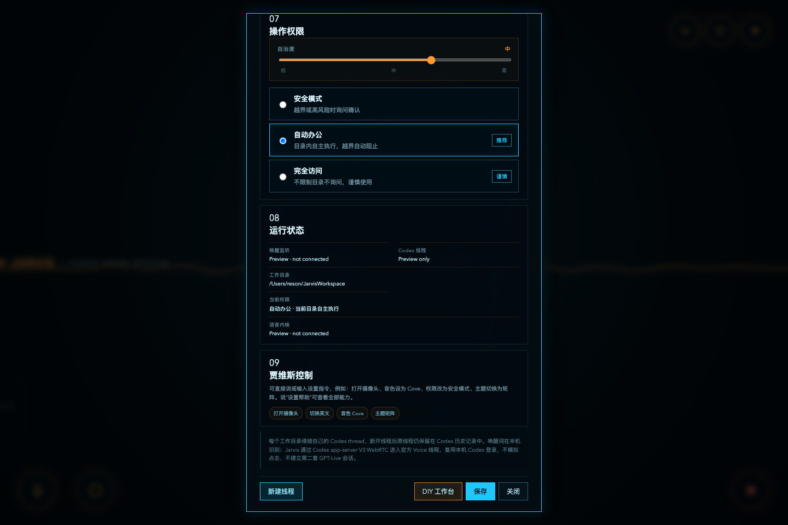
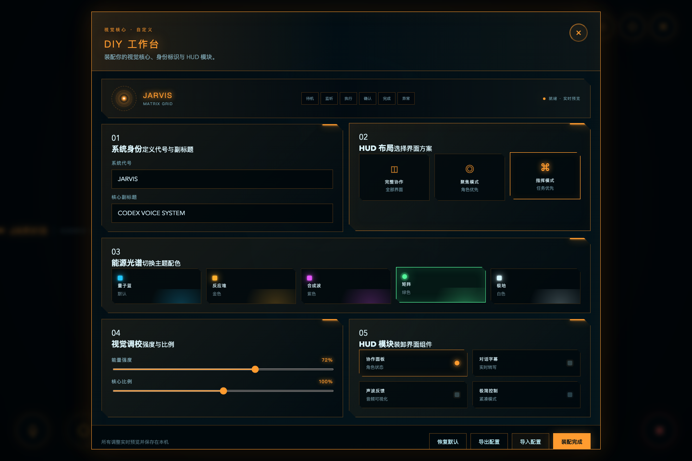

<p align="center">
  
</p>

<h1 align="center">Jarvis × Codex</h1>

<p align="center">
  一声“嗨 Jarvis”，让 Codex 从桌面醒来。
</p>

<p align="center">
  <a href="README.md">English</a> · 简体中文
</p>

<p align="center">
  <a href="https://github.com/ResonZone/jarvis-codex">ResonZone 代码仓库</a>
  ·
  <a href="https://github.com/Big-Guan/jarvis-codex">原始项目</a>
  ·
  <a href="CONTRIBUTING.md">参与贡献</a>
</p>

<p align="center">
  
</p>

Jarvis × Codex 是一个 macOS 本地语音工作入口。说出唤醒词后，透明窗口从桌面升起，
粒子与装甲碎片聚合成 Jarvis；随后通过 Codex app-server WebRTC 进入同一个
Codex 线程。你可以自然对话、打断回复、继续追问，也可以让 Codex 在选定项目中
真正执行任务。

> **维护分支说明（更新于 2026 年 8 月 10 日）：**本仓库基于
> [Big-Guan/jarvis-codex](https://github.com/Big-Guan/jarvis-codex) 修改，
> 原项目由 [Leo Zhang（@Big-Guan）](https://github.com/Big-Guan) 创建。
> ResonZone 版本保留完整上游历史，并新增摄像头手势、可拖动预览、对话驾驶舱、
> 扩展设置与视觉自定义功能。

> 当前状态：已在 macOS 26 Apple Silicon 实机验证唤醒、实时转写、语音回复和
> Codex 任务执行。Realtime conversation 仍是实验性的 Codex app-server 能力，
> 上游协议升级时可能需要同步适配。

## 主要能力

- 使用本机语音识别默认或自定义 Jarvis 唤醒词
- Tauri 2 + Rust + TypeScript 透明无边框桌面界面
- 通过 app-server V3 WebRTC 直接连接 Codex Voice
- 语音、文字、工具事件和任务执行共用同一个 Codex 线程
- 按规范化后的工作目录持久化并续接不同线程
- 支持自然轮流说话、回复中打断、连续追问和 STOP
- 提供 19 种可选实时音色（alloy、cove、echo、shimmer、verse 等）
- 音频驱动的口型同步与粒子场，实时响应说话音量
- 支持九种单手与双手动作，控制停止/拒绝、授权、语音、面板、设置和旋转
- 摄像头预览只显示实时画面，可自由拖动并记忆位置
- 内置手势说明、对话驾驶舱、任务仪表盘和 DIY 工作台
- 允许通过文字或 Voice 自然语言直接控制全部可编辑设置
- 提供安全、自动办公和完全访问三档权限
- 可在设置中选择登录时后台启动，唤醒后升起窗口
- Voice 临时不可用时可以使用文字输入

Jarvis 不模拟点击 Codex 或 ChatGPT 窗口，不绑定全局热键，也不创建第二套
GPT-Live 会话。它复用本机 Codex 的登录状态和 app-server runtime。

## 最新功能展示

### 手势控制 v2



支持七项单手动作与两项双手快捷动作。全局释放锁会要求手势先回到自然状态，再接受
下一条动作，从而减少握拳、张掌和点赞之间切换时的误触。

### 贾维斯控制全部设置



可以直接说或输入“打开摄像头”“音色设为 Cove”“权限改为安全模式”“主题切换为矩阵”
等指令。摄像头仍需要 macOS 授权，完全访问仍强制二次确认。

### DIY 视觉工作台



支持系统代号、副标题、五套能源主题、三种 HUD 布局、能量强度、角色比例和界面模块
的实时预览与本机持久化。

## 视觉演进

### v0.1.x：全息工作台


第一版采用完整 HUD 工作台，任务角色、对话记录、文字输入和 STOP 控制常驻页面，
重点是让用户清楚地看到 Codex 正在做什么。

### v0.2.0：透明角色界面

第二版让 Jarvis 本身成为界面。唤醒时，粒子、装甲碎片与能量环聚合成完整角色；
鼠标移入角色区域后才显示控制按钮。音频电平和任务状态会驱动呼吸、扫描、确认、
等待授权、完成和异常等视觉反馈。

视觉层只消费已有的音频、转写和任务事件，不替换唤醒监听、WebRTC 连接、工作目录
线程续接、权限模式或任务中断逻辑。

### ResonZone 更新：手势控制与驾驶舱

当前分支增加了可离线运行的 MediaPipe 手势识别，支持 GPU 失败后自动切换 CPU；
手势 v2 同时识别两只手，并使用全局释放锁，姿势切换过程不会误触第二条指令。
摄像头预览可以拖动，手势说明被移到设置面板，不再覆盖实时画面。

## 摄像头手势

将手完整放入摄像头画面：单手动作保持约 0.3 秒，双手组合保持约 0.4 秒。每次触发
后让手回到自然状态，再做下一个手势。

| 手势 | 动作 |
| --- | --- |
| 拇指向下 | STOP；有授权弹窗时拒绝操作 |
| 张开手掌 | 打开或关闭任务仪表盘 |
| 握紧拳头 | 确认；有授权弹窗时允许一次 |
| 拇指向上 | 批准或完成 |
| V 字胜利手势 | 打开或关闭对话驾驶舱 |
| “我爱你”手势 | 让 Jarvis 进行 360° 旋转 |
| 食指向上 | 开始或结束语音对话 |
| 双手同时张开 | 打开或关闭系统设置 |
| 双手同时握拳 | 打开或关闭 DIY 工作台 |

可以在应用内打开**设置 → 手势控制 → 查看手势**查看同样的说明。摄像头小窗只显示
实时画面，可以将它拖到 Jarvis 窗口内的任意位置。

## 自然语言控制设置

文字输入和 Voice 语音都可以直接修改全部可编辑设置。打开设置后，在“贾维斯控制”
卡片中也可以查看示例。

| 范围 | 示例指令 |
| --- | --- |
| 摄像头与启动 | “打开摄像头”“关闭后台启动” |
| 语言、音色、唤醒词 | “切换为英文”“音色设为 Cove”“唤醒词改为星期五” |
| 工作目录与权限 | “工作目录设为 /Users/me/project”“权限改为安全模式” |
| DIY 外观 | “主题切换为矩阵”“布局改为指挥中心”“能量强度设为 88” |
| 角色与 HUD | “角色比例设为 110”“隐藏协作面板”“系统代号改为 Friday” |
| 查询与导航 | “显示所有设置”“设置帮助”“打开 DIY 工作台” |

摄像头仍需 macOS 系统授权；开启“完全访问”时仍会弹出确认，避免语音误触扩大权限。
在 Voice 会话中修改唤醒词时，新唤醒词会保存，并在当前会话结束、麦克风释放后启用。

## 工作原理

```text
JarvisWakeListener（本机语音识别）
        ↓
Tauri / Rust 宿主升起 Jarvis 窗口
        ↓
唤醒监听器释放麦克风
        ↓
WebView 创建 WebRTC offer
        ↓
Codex app-server V3 realtime conversation
        ↓
语音、文字、工具和项目任务共用一个 Codex 线程
```

Swift 唤醒 helper 与 Voice 会话不会同时采集麦克风。运行时、线程生命周期和信任
边界详见[架构文档](docs/ARCHITECTURE.md)。

## 快速开始

1. 在 Mac 上安装并登录 Codex App、ChatGPT App 或 Codex CLI。
2. 下载最新 DMG，把 `Jarvis Codex` 拖入“应用程序”。
3. 首次启动时允许麦克风和语音识别权限。摄像头权限是可选的，只会在启用手势控制
   时请求。
4. 打开设置，选择希望 Codex 工作的项目目录。
5. 关闭窗口，让 Jarvis 留在后台监听。
6. 对电脑说“嗨 Jarvis”，窗口升起后直接说出任务。
7. 将鼠标移到 Jarvis 上显示控制按钮；点击 `STOP` 可中断 Voice 和当前任务。

Voice 暂时不可用时，可以使用底部文字输入框。语音和文字都会进入当前工作目录所
对应的线程。

## 权限模式

| 模式 | Sandbox | 审批策略 | 使用场景 |
| --- | --- | --- | --- |
| 安全模式 | `workspace-write` | `on-request` | 需要时确认操作 |
| 自动办公 | `workspace-write` | `never` | 在当前工作目录内自主执行 |
| 完全访问 | `danger-full-access` | `never` | 用户明确启用的高信任任务 |

权限配置由 Rust 宿主验证，前端不能传入任意 sandbox 或审批策略字符串。

## 系统要求

普通使用：

- macOS 13 或更高版本
- 当前发布的 DMG 面向 Apple Silicon
- 已安装并登录 Codex App、ChatGPT App 或 Codex CLI
- 麦克风和语音识别权限
- 启用手势控制时需要摄像头权限

源码开发：

- Node.js 20 或更高版本
- Rust stable，并安装 `rustfmt` 和 `clippy`
- Xcode Command Line Tools 和 Swift

## 本地开发

```bash
npm ci
npm run check
npm run dev
```

设置开发时的初始工作目录：

```bash
JARVIS_WORKSPACE=/absolute/path npm run dev
```

也可以在 Jarvis 设置面板中保存工作目录。

## 测试

提交 Pull Request 前请运行：

```bash
npm run check
npm run build
```

如果修改了唤醒、麦克风、Voice、STOP、线程续接、权限或打包逻辑，还需要在真实
macOS 环境执行 smoke test。现有自动化测试会检查重要协议与生命周期约束，但不能
证明实验性 realtime 服务和 macOS 隐私授权端到端正常。

仓库还包含 Playwright 交互测试，用于验证手势说明、纯画面预览、拖动边界和位置
记忆：

```bash
python3 /path/to/webapp-testing/scripts/with_server.py \
  --server "npm run web:dev -- --host 127.0.0.1" --port 1420 \
  python3 tests/gesture-hud-ui.py
```

界面功能更新后，可以用可复现脚本重新生成 README 截图：

```bash
python3 /path/to/webapp-testing/scripts/with_server.py \
  --server "npm run web:dev -- --host 127.0.0.1" --port 1420 \
  python3 scripts/capture-readme-images.py
```

## 构建

```bash
npm run build
```

预期产物：

- `src-tauri/target/release/bundle/macos/Jarvis Codex.app`
- `src-tauri/target/release/bundle/dmg/Jarvis Codex_0.2.0_aarch64.dmg`

构建脚本会生成并签名 `JarvisWakeListener.app`，生成的 app bundle 不进入 Git。

## 生产发布

本地构建默认使用 ad-hoc 签名身份 `-`。公开分发必须使用 Apple Developer ID
Application 证书并完成 notarization，不应把 ad-hoc 构建描述为生产版本。

签名、公证、entitlement 和 smoke test 要求见[生产发布清单](docs/PRODUCTION.md)。

## 隐私与安全

- 唤醒词强制使用本机语音识别。
- 只有唤醒后，麦克风音频才进入 Codex Voice。
- Jarvis 不保存原始音频和登录凭据。
- WebView 使用限制性内容安全策略。
- 自动办公模式限制在选定工作目录内。
- 完全访问必须由用户主动选择。
- Siri 不参与主链路。

安全问题请按照 [SECURITY.md](SECURITY.md) 私下报告，不要创建公开 Issue。

## 开源许可证

Jarvis × Codex 使用 [GNU General Public License v3.0](LICENSE) 开源。

## 原作者与贡献者

- **原作者及上游维护者：**[Leo Zhang（@Big-Guan）](https://github.com/Big-Guan)
- **当前分支维护及新增功能：**[Ruiyangz（@ResonZone）](https://github.com/ResonZone)

本分支保留上游 Git 提交历史、原作者署名及 GPLv3 许可证。上游项目和完整贡献记录
请查看[原始仓库](https://github.com/Big-Guan/jarvis-codex)。

## 参与贡献

欢迎参与项目贡献。请创建职责明确的分支，并向当前维护分支提交 Pull Request。
开始开发前请阅读 [CONTRIBUTING.md](CONTRIBUTING.md)。
