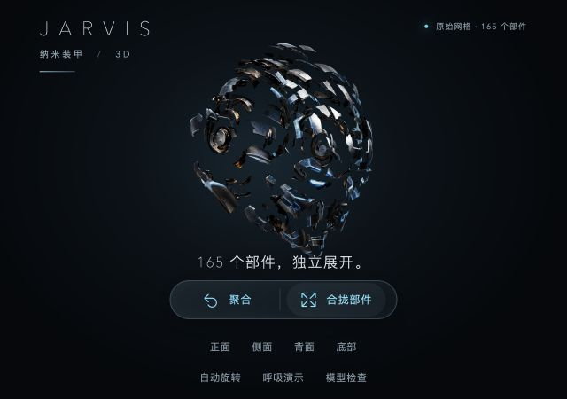

# 模型与运行资源

## 纳米装甲

`public/models/nano-armor.glb` 是项目使用的 Tripo 分部件导出模型。原始几何和内嵌纹理保留，应用通过代码驱动各网格的位置、旋转和状态灯光。

| 项目 | 数值 |
| --- | --- |
| 文件大小 | 63,707,520 字节 |
| 网格 / 材质 | 165 / 165 |
| 三角面 | 1,906,703 |
| 顶点 | 1,023,864 |
| 内嵌贴图 | 495 |
| SHA-256 | `61a96fd16be410fcfaa72a169e7c675d1a328246722c4756a0a944528c2976be` |

模型没有内置动画；出场、散落、聚合和呼吸由应用实现。修改显示像素倍率不改变模型精度。

下图是独立模型预览的历史截图，不代表桌面上保留这些按钮。

## MediaPipe

`public/mediapipe/` 包含手势识别模型与配套 WASM，使摄像头识别不依赖在运行时下载 CDN 脚本。JavaScript / WASM 对应锁定的 `@mediapipe/tasks-vision` 1.1.1；其 npm 包声明为 Apache-2.0，相关源文件中的版权和许可头保留，随附 [Apache 2.0 许可文本](../public/mediapipe/LICENSE-2.0.txt)。

更新时应同时核对依赖版本、WASM 和模型兼容性，再执行手势引擎与真实摄像头验证。仓库中已有模型原件，无需用户重新生成或下载。

## 其他资源

图标、旧版界面图和概念图沿用项目素材。`docs/screenshots/0.4.6-presence-preview.png` 是实际原生外观页截图；旧版参考界面保存在 `docs/images/`，与新版功能截图分别说明。

项目代码许可见 [LICENSE](../LICENSE)。第三方组件各自的原有声明仍应保留。
